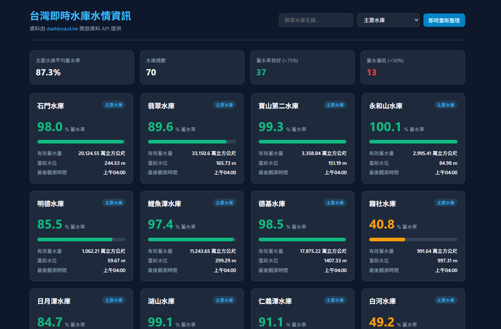

# dashboard.tw-WaterMonitor

[](https://dashboard.tw)
[](LICENSE)



全臺水庫即時水情監測儀表板，由 [dashboard.tw](https://dashboard.tw) 提供 API 服務。

透過 [dashboard.tw 開放資料 API](https://dashboard.tw/developers) 之水利署「水庫水情（每小時）」資料集，提供乾淨現代的卡片式即時觀測畫面。

---

## 🌟 功能亮點

- **即時全臺水庫數據**：蓄水百分比、有效蓄水量（萬立方公尺）、水位與觀測時間。
- **警戒狀態視覺化**：顏色自動切換（良好 >60% 綠色、警戒 30-60% 橙色、嚴重警戒 <30% 紅色）。
- **水庫篩選與即時搜尋**：支援「主要水庫」、「警戒水庫 (<50%)」與關鍵字搜尋。
- **嚴格 API 防刷保護機制**：
  - **後端記憶體快取 (TTL 10m)**：不論有多少訪客瀏覽或重新整理，後端每 10 分鐘最多僅向 dashboard.tw 請求一次，避免耗盡每日額度。
  - **ETag (HTTP 304)**：支援 `If-None-Match`，資料未更新時不消耗傳輸流量。
  - **訪客 IP 速率限制 (Rate Limiting)**：單一訪客 IP 每分鐘最多 30 次請求，超額回傳 429。
  - **前端防連點冷卻機制**：重新整理按鈕內建 10 秒冷卻倒數，防止連續點擊。
  - **OAuth 2.0 Token 快取**：自動管理 Access Token，有效期間內重用，避免頻繁驗證請求。
- **無外部套件依賴**：原生純 HTML/CSS/JS + Node.js 內建模組，極輕量且安全。

---

## 🚀 快速開始

### 1. 取得 dashboard.tw 憑證
1. 前往 [dashboard.tw](https://dashboard.tw) 登入。
2. 至 [API 憑證](https://dashboard.tw/me/api-key) 建立一組 Client ID 與 Client Secret。

### 2. 設定環境變數
```bash
# Windows PowerShell
$env:DASHBOARD_TW_CLIENT_ID="你的 Client ID"
$env:DASHBOARD_TW_CLIENT_SECRET="你的 Client Secret"

# Linux / macOS
export DASHBOARD_TW_CLIENT_ID="你的 Client ID"
export DASHBOARD_TW_CLIENT_SECRET="你的 Client Secret"
```

### 3. 啟動本機伺服器
```bash
node server.js
```
開啟瀏覽器前往：`http://localhost:3000`

---

## ☁️ 雲端部署 (Vercel)

本專案已內建 [`vercel.json`](vercel.json) 與 Serverless 支援，可直接免費託管：

1. 前往 [Vercel](https://vercel.com/)，點選 **Add New Project** 並匯入本 GitHub 倉庫。
2. 在 **Environment Variables** 新增兩組環境變數：
   - `DASHBOARD_TW_CLIENT_ID`：您的 Client ID
   - `DASHBOARD_TW_CLIENT_SECRET`：您的 Client Secret
3. 點擊 **Deploy** 即完成部署！
4. **自訂網域**：前往專案的 **Settings > Domains** 新增您的自訂網域（如 `water.kevin.com.tw`），並至 DNS 設定對應的 `CNAME cname.vercel-dns.com` 即可。

---

## 📂 專案結構

```
dashboard.tw-WaterMonitor/
├── .env.example       # 環境變數範例檔
├── .gitignore
├── Dockerfile         # 容器部署配置
├── LICENSE
├── README.md
├── package.json
├── server.js          # 本機/VPS 後端服務（記憶體快取、IP 限速、Token 快取）
├── vercel.json        # Vercel 路由設定
├── api/
│   └── index.js       # Vercel Serverless Function 處理器
└── public/
    └── index.html     # 前端響應式水情儀表板介面
```

---

## 📄 授權條款

以 [MIT License](LICENSE) 授權釋出。
資料來源：[dashboard.tw 開放資料 API / 經濟部水利署](https://dashboard.tw/developers/datasets/reservoir_obs)。
